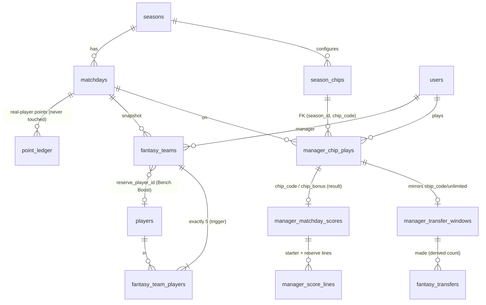

# Fantasy Chips — Product & Technical Plan

> **Status:** In progress — Phase 1 (pure domain) landed; migration and wiring follow in later phases.
> **Date:** 2026-11-06
> **Amends:** [`TRANSFERS_PLAN.md`](./TRANSFERS_PLAN.md) (§5 "Chips: design constraints" is superseded in detail by this document) and [`TRANSFERS_ENABLE.md`](./TRANSFERS_ENABLE.md).
> **Scope:** Mkate Champions League — private Sunday 5-a-side fantasy league, ~12 matchdays per ~3-month season, ~12 managers.

> **About "the existing approved plan":** the repo has no single master plan document. The approved product/technical plan is the **as-built system** plus `docs/TRANSFERS_PLAN.md` (which is now implemented — migration `0008_transfers.sql`, `submit-team`, balance chain, transfers UI, admin transfers). This document is written as the next amendment in that series and is grounded in the code that exists today (file references below are real). If the approved plan lives somewhere else, tell me and I will merge this into it.

---

## 0. Summary of proposed changes

1. **Four chips** — Triple Captain, Wildcard, Free Hit, Bench Boost — each usable **once per season**, **one chip per matchday**, activated **before the deadline**, recorded historically.
2. **Chips are plays on a matchday, not new game modes.** A chip play is a fact (`manager_chip_plays`), validated and written **in the same transaction as the squad submission** (the existing `submitTeam` flow, evolved), so squad + captain + reserve + chip can never disagree.
3. **Chip behaviour lives in a small code registry**, with **per-season availability rows in the database** (`season_chips`). Adding a chip next season = one registry entry + one config row; the scoring engine is not rewritten.
4. **Scoring stays a deterministic pipeline** (extending the 6 stages from `TRANSFERS_PLAN` §4). Chips only change *which players' points count and how they are multiplied* (Triple Captain, Bench Boost), or *which squad is used / whether transfers are free* (Free Hit, Wildcard). **Chips never modify real-player points** (`point_ledger` is untouched).
5. **Free Hit never touches the permanent squad.** The temporary squad is a separate kind of squad row that the squad-lineage functions skip, so the original team returns automatically — including after admin corrections and recomputes. **This requires changing the lineage functions** (important finding in §1.2).
6. **Bench Boost reserve: recommended "only when activated" (Option B).** The 6th player is chosen only when the manager plays the chip, stored on that matchday's snapshot (`fantasy_teams.reserve_player_id`), never permanent. This keeps the 5-player core, the transfer maths and the DB invariant (`exactly 5 players`) untouched. The reserve can **not** be captain/vice.
7. **Transfer interaction (already half-built):** Wildcard and Free Hit make the window `unlimited` (no penalty). The free-transfer allowance for that matchday is **preserved** (`carry = base`), exactly what `computeBalanceChain` already does for `unlimited`. Triple Captain and Bench Boost do not touch transfers.
8. **Additive migration, opt-in per season.** No chips are offered until a season has enabled `season_chips` rows; existing behaviour and tests are unchanged.
9. **Mobile-first Chips experience:** a Chips tab with status cards, a right-hand drawer per chip explaining the effect, a deliberately deliberate confirm step, an "active chip" banner, and chip-specific pitch treatments (§8).
10. **Admin tooling:** usage table, season chip configuration, audited void/force-activate, and chip contribution shown in the scoring inspector (§9).

---

## 1. Current behaviour (as built) and what it means for chips

### 1.1 What exists today (relevant to chips)

| Area | As built | Where |
|---|---|---|
| Squad snapshot | One row per `(manager, matchday)` in `fantasy_teams` (unique index) + exactly 5 rows in `fantasy_team_players`. `source` ∈ `manual / carry_over / admin`. `version` for optimistic concurrency. | `schema.ts`, `0008_transfers.sql` |
| Player-count invariant | **Deferred constraint trigger** `fantasy_team_players_count_check` raises if a team does not have exactly 5 players at commit. | `0008_transfers.sql` |
| Submit | `submitTeam`: one transaction — manager active → per-manager advisory lock → matchday `FOR UPDATE` → DB-time lock check → **next open matchday only** → idempotent replay (`pickEquals`) → version check → initial build *or* transfer validation → penalty acknowledgement → squad update in place → `syncManagerTransferMaterialisation`. | `domain/submit-team.ts` |
| Transfer facts | `fantasy_transfers` (diff rows, `active/void`), `manager_transfer_windows` (**already has `chip_code` text and `unlimited` bool**), `manager_free_transfer_adjustments`. | `schema.ts` |
| Balance chain | `computeBalanceChain`: `unlimited` ⇒ `extra = 0`, `carry = base_m` (allowance preserved). Cancelled matchdays skipped. | `fantasy/free-transfers.ts` |
| Penalty | `deriveTransferPenalty` returns 0 when `unlimited`; `loadTransferPenaltiesForMatchday` reads windows + active transfer rows and **never writes**. | `domain/transfer-penalty.ts` |
| Lineage | `resolveBaseSquadPlayerIds` and `resolveEffectiveTeam` use the **latest earlier `manual`/`admin` squad** as the base/carry-over. | `fantasy/transfer-base-squad.ts`, `fantasy/effective-team.ts` |
| Scoring | `scoreManagers(rules, playerPoints, attended, teams, transferPenalties)`: multiplier player = captain if attended else vice if attended else none; `points = base × rules.captainMultiplier`; `squadPoints`, `transferPenalty`, `totalPoints`. | `scoring/manager-score.ts` |
| Recompute | `rebuildManagerScoresFromMatchday` deletes and rebuilds lines/scores from matchday N forward, re-materialises `carry_over` squads, and **reads** transfer facts. | `domain/recompute-manager-scores.ts` |
| Cancel | Voids transfers + windows and **deletes `manual`/`admin` squads for that matchday**, then recomputes. | `domain/cancel-matchday-transfers.ts`, `matchdays-admin.ts` |
| Config | `scoring_rule_sets` (points, `captain_multiplier`, transfer rule columns), referenced by `seasons.rule_set_id`; transfers on from `transfers_start_matchday`. | `schema.ts` |
| Admin | Transfers panel, rules form, corrections with `audit_log`. | `components/admin/admin-transfers-panel.tsx` |

### 1.2 Findings / conflicts the chips design must resolve

| # | Finding | Why it matters | Resolution |
|---|---|---|---|
| **K1** | **Free Hit would silently become permanent.** `resolveBaseSquadPlayerIds` / `resolveEffectiveTeam` / carry-over materialisation take the latest earlier `manual`/`admin` squad as the next base. A temporary squad saved as a normal row would become next week's base. | The most dangerous bug the feature could ship. | Add a squad **kind** (`permanent` / `free_hit`) and make every lineage function ignore `free_hit` rows (§7.2, §3.3). |
| **K2** | **DB trigger forces exactly 5 players per team.** | A sixth (reserve) player cannot live in `fantasy_team_players` without relaxing a hard invariant used by transfers. | Store the reserve as a nullable column on `fantasy_teams`, keeping the table and trigger untouched (§7.2). |
| **K3** | `pickEquals` (idempotent replay) compares squad + captain + vice only. | A chip-only change (e.g. Triple Captain) would be treated as a no-op replay and silently dropped. | Replay equality must include `chip`, `reserve`, and the squad kind. |
| **K4** | `submitTeam` returns early for "no change" **before** version/penalty checks. | Same: chip changes must not short-circuit. | Evaluate the full desired state `{squad, captain, vice, reserve, chip}`. |
| **K5** | Cancel deletes all `manual`/`admin` squads of the matchday. | Good for Free Hit (its row has `source='manual'`), but chip plays and reserve must also be voided/refunded. | Extend `voidTransferFactsForCancelledMatchday` to void chip plays (refund). |
| **K6** | `manager_transfer_windows.chip_code` / `unlimited` already exist but nothing writes them. | Two representations of "this window has a chip" would drift. | The chip play is the **source of truth**; window `chip_code`/`unlimited` are written only by the single submit path from that play (§3.5). |
| **K7** | Initial build is not a transfer window (no window row). | Wildcard/Free Hit are meaningless on the initial build (everything is already free; no permanent team to restore). | Chip legality rules (§3.2). |
| **K8** | `scoreManagers` takes one global `captainMultiplier` from rules. | Triple Captain needs a per-manager multiplier. | Chip effects computed by a pure function and passed in; multiplier for the captain becomes `chipMultiplier ?? rules.captainMultiplier`. |
| **K9** | `loadSubmittedTeamsForSeason` / `SubmittedFantasyTeam` carry no kind or reserve. | Lineage filter and scoring need them. | Add `kind` and `reservePlayerId` to the type and loader. |

---

## 2. Functional requirements (additions)

### Chips — general
- **FR-C1** Four chips exist: **Triple Captain, Wildcard, Free Hit, Bench Boost**.
- **FR-C2** Each chip can be played **once per season** per manager. A manager can play **at most one chip per matchday**.
- **FR-C3** A chip can only be played, changed or cancelled **before the matchday deadline**, for the **next open matchday**, by an **active** manager. After the deadline everything about the chip is locked.
- **FR-C4** Managers see, for every chip: **available / active this gameweek / used (with the gameweek) / unavailable (with the reason)**.
- **FR-C5** Chip usage is recorded historically (who, which chip, which matchday, when, by whom).
- **FR-C6** Activation is **idempotent**: repeating a request or retrying after a network failure can never consume a chip twice.
- **FR-C7** Chip availability resets each season (it is keyed by season).
- **FR-C8** Chips never alter real players' points, the player standings, or awards.

### Per chip
- **FR-TC** Triple Captain: captain ×3 instead of ×2 (§3.4).
- **FR-WC** Wildcard: unlimited free transfers that become the **permanent** squad (§3.3).
- **FR-FH** Free Hit: temporary 5-player squad for one matchday; the permanent squad returns automatically (§3.3).
- **FR-BB** Bench Boost: a 6th reserve player's points count for that matchday (§3.4).

### Admin
- **FR-A1** View/inspect all chip plays; configure chips per season; void (refund) or force-activate with a reason; everything audited; nothing silently rewritten.

---

## 3. Game rules and chip specifications

### 3.1 Common rules

| Rule | Specification |
|---|---|
| Uses | One use per chip per season (DB-enforced for active plays). |
| Per matchday | At most one **active** chip play per manager per matchday (DB-enforced). |
| Deadline | DB time, same lock check as squads (`isSelectionOpen`). |
| Target matchday | The **next open matchday** only (same as transfers). |
| Not cancelled | Cancelled matchdays accept no plays; existing plays are voided and **refunded** (§6). |
| Window mutability | While the matchday is open, a chip play is a **plan**: the manager can change or cancel it freely. After the deadline it is immutable except by an audited admin correction. |
| Cancelling your own chip | Allowed until the deadline; the chip returns to "available". Squad changes made under the chip are re-validated under normal rules (§4.3). |
| Visibility | Other managers see a manager's chip only **after the deadline** (same rule as teams). |

### 3.2 Chip legality (server-side, in the submit transaction)

A chip can be played only if **all** hold:
1. The chip exists and is **enabled for this season** (`season_chips`) and the matchday number ≥ its `available_from_matchday` (default 1).
2. The manager has **not already used** this chip this season (no other active play of this chip).
3. The manager has **no other active chip** on this matchday.
4. **Wildcard / Free Hit** additionally require that transfer rules **apply to this matchday** (`transfersStartMatchday` reached) **and** the manager already has a **base squad** (i.e. this is *not* their initial build). On the initial build everything is already free and there is nothing to rebuild or restore — playing either chip would be wasted, so the server rejects it (`CHIP_NOT_APPLICABLE`) and the UI shows "Available from your second squad".
5. **Bench Boost** requires a valid reserve (§3.4). **Free Hit** requires a valid temporary squad (§3.3).
6. The desired chip state is consistent with the submitted squad (e.g. a reserve is present iff Bench Boost; a Free Hit squad kind iff Free Hit).

### 3.3 Squad-affecting chips

#### Wildcard — permanent rebuild
- The matchday's window becomes **`unlimited`**: any number of transfers, `extra = 0`, **no penalty**.
- The submitted squad is saved as a **normal permanent squad** — it **becomes the base squad for the next matchday**. Wildcard is permanent; nothing is restored.
- Transfer rows are still materialised (diff vs. base) so history can show "Wildcard: 4 changes".
- Free-transfer allowance: **preserved** — `carry_m = base_m` (§5.1).
- Zero transfers with a Wildcard is **allowed** (the server does not second-guess the manager) but the UI warns that the chip would be spent without changing the team.

#### Free Hit — temporary team
- The manager builds a **temporary 5-player squad** for this matchday only (any active players; validated like an initial build, not as transfers).
- Stored as a `fantasy_teams` row with **`squad_kind = 'free_hit'`**. **The permanent squad for this matchday is simply not stored** — it is implied by the base squad.
- **Lineage ignores `free_hit` rows** (K1). The next matchday's base squad is the latest earlier **permanent** squad, so the original team returns automatically — there is **no "restore" job and nothing to forget**.
- Transfer facts: **no `fantasy_transfers` rows** for a Free Hit matchday (the temporary squad is not a transfer). The window is `unlimited`, `extra = 0`.
- Free-transfer allowance: **preserved** — `carry_m = base_m`; the manager is treated as if they had saved their transfers (§5.1).
- Captain and vice-captain are chosen **for the temporary squad**. Captain/vice of the permanent squad are untouched and apply again from the next matchday (the next matchday's default captaincy comes from the last permanent squad).
- Scoring for the matchday uses the Free Hit squad (it is the matchday's squad row). Admin corrections to events or to the temporary squad recompute from facts and **cannot leak into the permanent squad** (it lives only in lineage-visible rows).
- **Activating** Free Hit **discards any pending permanent changes the manager planned for that matchday** (their pending permanent row is deleted in the same transaction; the UI warns first). **Cancelling** Free Hit before the deadline deletes the temporary row — the manager is back to the base squad with nothing pending.

### 3.4 Score-affecting chips

#### Triple Captain
- Chip multiplier **3** (value snapshotted on the play from `season_chips.params`, default `{ "multiplier": 3 }`) replaces the normal captain multiplier for the **captain only**.
- **Vice-captain fallback:** if the captain **did not attend**, the vice-captain takes over with the **normal** multiplier (`rules.captainMultiplier`, default 2) — as specified, the vice does **not** inherit ×3. The Triple Captain is then **wasted** (no refund). The UI warns about this risk at activation (D8).
- If neither captain nor vice attended: no multiplier player; no bonus (chip wasted).
- Example: captain has 12 base points → normal 24; Triple Captain 36 (`chip_bonus = +12`).

#### Bench Boost
- **Reserve selection (recommended Option B — see D1):** the manager picks one extra **active** player, **not** among their five, **only when playing the chip**. Stored on that matchday's snapshot as `fantasy_teams.reserve_player_id`. It is **never permanent**: it is not copied to carry-over squads and does not appear in the next matchday.
- **Scoring:** the reserve's base points are counted **×1** in the matchday's squad points. The reserve is **not eligible** for captain/vice and never gets a multiplier (D2).
- If the reserve **does not attend**, they score 0 and the chip is wasted (no refund); the UI warns the manager to pick a likely attendee, ideally showing expected points.
- Without Bench Boost the reserve concept does not exist for that matchday.
- Bench Boost does **not** affect transfers or the base squad. The reserve is not "owned" and cannot be transferred.

### 3.5 Where the "active chip" lives (single source of truth)

- **`manager_chip_plays` is authoritative** for "which chip, which matchday".
- `manager_transfer_windows.chip_code` / `unlimited` are **derived mirrors** written **only by the submit service, in the same transaction** as the play (Wildcard/Free Hit ⇒ `unlimited = true`, `chip_code = <code>`; otherwise null/false). An integration test asserts the invariant. Scoring reads the **play** for chip effects and the **window** for the penalty (which already exists).
- `manager_matchday_scores.chip_code` / `chip_bonus` are **results** (derived, recomputed deterministically), not inputs.

---

## 4. Transfer ⇄ chip interaction

### 4.1 Rules per chip

| Chip | Transfers in that window | Penalty | Permanent squad | Free-transfer balance after the window |
|---|---|---|---|---|
| **Triple Captain** | Normal rules (free/extra as usual) | Normal | Normal | Normal (`carry = max(0, A − used)`) |
| **Bench Boost** | Normal rules | Normal | Normal | Normal |
| **Wildcard** | Unlimited, recorded as transfers | **0** | **Replaced permanently** | **Preserved:** `carry = base_m` |
| **Free Hit** | None recorded (temporary squad ≠ transfers) | **0** | **Unchanged** (original returns) | **Preserved:** `carry = base_m` |

`base_m = min(cap, carry_{m−1} + grant)` (existing definition). "Preserved" means the matchday behaves like a window in which the manager **saved everything**: they keep the bank they had **plus this matchday's grant**, capped at 3 by the existing `min(cap, …)`.

### 4.2 Anti-exploitation analysis

| Attempted exploit | Why it fails |
|---|---|
| Play Wildcard, then keep unlimited changes by re-submitting | Chip play is **state, not an event**; one play per season; window is derived from it. |
| Use Free Hit to pre-build a team and "carry" it into next week | Lineage ignores `free_hit` rows; next base = last permanent squad. |
| Use Free Hit to dodge penalties on real transfers | Free Hit window records **no transfers**; any permanent change must happen in a different (non-Free-Hit) window under normal rules. |
| Plan 4 transfers (−8), then switch to Wildcard before the deadline to erase the penalty | Allowed and **legitimate** — that is exactly what the chip is for, and it spends the Wildcard. |
| Plan Wildcard rebuild, then cancel the chip to keep the free rebuild | Removing the chip is a **new full submission**: the server recomputes transfers vs. the base squad and requires `acknowledgedPenalty` (`PENALTY_NOT_CONFIRMED`). No free path. |
| Stack chips (e.g. Free Hit + Triple Captain) | One active chip per matchday (DB partial unique index). |
| Reuse a chip by deleting/recreating the play | Pre-deadline edits are plans; after the deadline the play is immutable; use count is derived from active plays. Admin refunds are audited. |
| Abuse preserved allowance by chaining chips every week | Each chip is once per season; the cap of 3 bounds the bank. Worst case: a manager preserves a full bank across **two** chip matchdays — an intended, bounded benefit. |
| Concurrent duplicate activation | Per-manager advisory lock + partial unique indexes (`(manager, matchday)` and `(manager, season, chip)` where active). |

### 4.3 Order of operations in the submit transaction

1. Existing guards (manager active, advisory lock, matchday `FOR UPDATE`, not cancelled, DB-time deadline, next open matchday).
2. Resolve desired state `{ playerIds, captain, vice, reserve?, chip? }`.
3. **Chip legality** (§3.2) against `season_chips` + active plays.
4. Compute the window: base squad (**permanent-only** lineage), `freeAvailable`, `unlimited = chip ∈ {wildcard, free_hit}`.
5. Validate the squad under the right rules: initial build / transfer pick / **free-hit pick** (any 5 active) / reserve validity.
6. Compute the summary and require `acknowledgedPenalty` **unless `unlimited`**.
7. Persist: squad row (kind permanent or free_hit), reserve, transfer rows (not for Free Hit), window (+ mirrors), chip play — all or nothing.
8. Idempotent replay: if the stored desired state already equals the request, return success **without** side effects. Replay equality includes chip, reserve and squad kind (K3/K4).

---

## 5. Scoring specification

### 5.1 Free-transfer balance with chips (extends `TRANSFERS_PLAN` §3.3)

```
base_m  = min(cap, carry_{m-1} + grant)
A_m     = base_m + adjustments_m
if window.unlimited:            # Wildcard or Free Hit
    extra_m = 0 ; penalty_m = 0
    carry_m = base_m            # allowance preserved (as built in computeBalanceChain)
else:
    extra_m = max(0, made_m − A_m) ; penalty_m = extra_m × penaltyPerExtra
    carry_m = max(0, A_m − made_m)
```

No code change to the maths is needed: this is already implemented. **Worked example** (grant 2, cap 3):

| Matchday | Chip | `base` | Made | Extra | Carry out |
|---|---|---:|---:|---:|---:|
| 1 | — | 2 | 0 | 0 | 2 |
| 2 | — | 3 | 2 | 0 | 1 |
| 3 | **Wildcard** (5 changes) | 3 | 5 (recorded) | **0** | **3** *(= base)* |
| 4 | — | 3 | 1 | 0 | 2 |
| 5 | **Free Hit** | 3 | 0 (none recorded) | **0** | **3** *(= base)* |
| 6 | — | 3 | 3 | 0 | 0 |

### 5.2 Deterministic calculation order (extends the 6 stages in `TRANSFERS_PLAN` §4)

| Stage | What happens | Chip involvement |
|---|---|---|
| **1. Underlying points** | Sum of `point_ledger` per real player. **Never modified.** | None — chips cannot touch this. |
| **2. Effective squad** | Matchday squad = the manager's snapshot for that matchday: **Free Hit squad** if Free Hit was played, otherwise the permanent squad (manual/admin/carry-over). | **Free Hit** selects which snapshot; **Bench Boost** adds the reserve. |
| **3. Attendance** | Players with no attendance are flagged `attended = false`. | — |
| **4. Multiplier player & value** | Captain if attended, else vice if attended, else none. Value: **captain** gets `chipMultiplier` (Triple Captain: 3) else `rules.captainMultiplier`; **vice fallback always** gets `rules.captainMultiplier`. | **Triple Captain** |
| **5. Lines & squad subtotal** | Five starter lines: `points = base × multiplier`. **Reserve line** (role `reserve`): `points = base × 1` if Bench Boost, else `points = 0` (base still recorded for "what you missed"). `squad_points = Σ points`. | **Bench Boost** |
| **6. Chip bonus (informational)** | `chip_bonus = squad_points − squad_points_without_chip` for Triple Captain / Bench Boost (recompute steps 4–5 with the chip disabled). `0` for Wildcard/Free Hit. | Display only |
| **7. Transfer penalty** | `transfer_penalty` from the window + active transfer rows (`unlimited` ⇒ 0). | **Wildcard / Free Hit** zero it. |
| **8. Total** | `total_points = squad_points + transfer_penalty` (existing DB `CHECK` keeps holding; chip effects are already inside `squad_points`). | — |

**Reproducibility:** everything is derived from recorded facts — match events (`point_ledger`, attendance), squad snapshots (incl. kind, reserve), chip plays (with snapshotted `params`), transfer rows/windows. Recompute (`rebuildManagerScoresFromMatchday`) rebuilds lines/scores and **never writes** chip plays, transfer facts or windows; running it N times gives identical numbers. Chip bonus is recomputed, not stored as an input.

### 5.3 Edge cases in scoring

| Scenario | Result |
|---|---|
| Triple Captain, captain attends, 12 base | `36` (+12 bonus) |
| Triple Captain, captain absent, vice attends (8 base) | vice `16` (×2), captain `0`; Triple Captain wasted, `chip_bonus = 0` |
| Triple Captain, captain and vice absent | no multiplier; `chip_bonus = 0` |
| Bench Boost, reserve attends (6 base) | `+6` (×1), `chip_bonus = +6` |
| Bench Boost, reserve absent | reserve line `0`, `chip_bonus = 0` |
| Reserve is also a high scorer but not captain | still ×1 (D2) |
| Wildcard with 4 changes at A = 2 | penalty `0` (would have been −8) |
| Free Hit squad scored | uses Free Hit snapshot; permanent squad unaffected |
| Admin corrects a goal | `point_ledger` changes ⇒ recompute ⇒ chip effects re-derived; penalties and plays unchanged |

---

## 6. Exceptional scenarios

| Scenario | Rule |
|---|---|
| **Cancelled matchday (D5)** | In the same transaction as the cancel: chip play is **voided and refunded**, the Free Hit squad row is deleted (already covered: it is a `manual` squad of that matchday), the reserve disappears with the squad row, the window is voided (existing). Managers see "GW cancelled — your chip was refunded." If the matchday was already **published**, the cancel path recomputes scores and the chain forward (existing) and the admin sees the chip impact in the preview. |
| **Postponed matchday** | Play stays attached to the matchday id; the (new) deadline applies. |
| **Season rollover** | Availability derives from `season_chips` + plays **of that season**; a new season starts with all chips available. No chip state carries over. |
| **Manager disabled/removed** | Cannot play chips; history remains; no recomputation of their past chip plays. |
| **Real player unavailable after deadline** | No chip compensation. Triple Captain/Bench Boost wasted if the captain/reserve doesn't attend (existing no-auto-compensation principle). |
| **Real player deactivated before the deadline** | Normal squad rules (retained inactive player allowed, can't be transferred in). Can't be chosen as Free Hit/Wildcard member or reserve. |
| **Admin corrects match events after Free Hit** | Recompute uses the Free Hit snapshot for that matchday only; permanent lineage unaffected. Tested explicitly. |
| **Admin corrects a Free Hit squad** | Admin override preserves `squad_kind` (cannot convert Free Hit ⇄ permanent silently). |
| **Admin corrects a permanent squad before a Free Hit week** | Lineage recomputes; Free Hit snapshots are independent. |
| **Manager joins mid-season** | Chips are available per rules (§3.2); Wildcard/Free Hit available from their first **transfer** window (second squad). |
| **No squad submitted but chip played** | Triple Captain: allowed with carried squad. Others require their squad parts in the same submission. |

---

## 7. Database design

### 7.1 Decision: extend, keep chips as facts, keep behaviour in code

- **Squads stay in `fantasy_teams`** (scoring, visibility, recompute, history all read it). Free Hit = a row with a different **kind**; Bench Boost = a **nullable reserve column** on the same row. This adds the fewest new read paths.
- **Chip behaviour in a code registry**, not DB rows: effects are code, so DB "definitions" would be a mirror that can drift.
- **Per-season availability in `season_chips`** so each season can enable/disable chips, restrict timing and tune parameters, and so a **foreign key** guarantees every play refers to a chip configured for that season. (Also avoids a Postgres enum that needs `ALTER TYPE` per new chip.)
- **Inventory is derived**, never a counter: `available = enabled AND NOT EXISTS active play`. No second representation to conflict.
- **No separate microservice or chip-engine process.** A chip is a pure function in the scoring pipeline plus a validator in the submit transaction.

### 7.2 New and changed tables

**`season_chips`** (new)
| Column | Type | Notes |
|---|---|---|
| `season_id` | uuid fk → seasons | PK part |
| `chip_code` | text | PK part (`triple_captain`, `wildcard`, `free_hit`, `bench_boost`); validated against the registry in app code |
| `enabled` | boolean default true | |
| `available_from_matchday` | integer default 1 | optional timing restriction (D4) |
| `params` | jsonb default `{}` | e.g. `{"multiplier":3}` for Triple Captain |
| `created_at` | timestamptz | |

Editable only before the season's first locked matchday (mirrors rule-set immutability).

**`manager_chip_plays`** (new — the chip fact)
| Column | Type | Notes |
|---|---|---|
| `id` | uuid pk | |
| `season_id`, `manager_id`, `matchday_id` | uuid fk | `manager_id` cascade like squads |
| `chip_code` | text | **FK `(season_id, chip_code)` → `season_chips`** |
| `status` | enum `active \| void` | `void` for refunds/cancellations/admin reversals |
| `source` | enum `manager \| admin` | admin force-activate |
| `params` | jsonb | **snapshot** of chip parameters at activation (reproducible history) |
| `activated_at` | timestamptz | |
| `voided_at`, `void_reason`, `voided_by` | | audit trail; `CHECK` that void fields are set iff `status='void'` |

Constraints: **partial unique** `(manager_id, matchday_id) WHERE status='active'` (one chip per matchday); **partial unique** `(manager_id, season_id, chip_code) WHERE status='active'` (once per season). While the matchday is open, an active play may be deleted/replaced by the submit service (it is a plan); after the deadline it is immutable except via the admin path.

**`fantasy_teams`** (changed — additive)
| Column | Type | Notes |
|---|---|---|
| `squad_kind` | enum `permanent \| free_hit`, default `permanent` | **Existing unique `(manager_id, matchday_id)` stays**: a Free Hit matchday has only the temporary row (the permanent squad is implied by lineage) |
| `reserve_player_id` | uuid null fk → players | Bench Boost only; `CHECK (reserve_player_id IS NULL OR (reserve_player_id <> captain_player_id AND reserve_player_id <> vice_captain_player_id))`; a small **deferred trigger** asserts the reserve is not among the 5 players and is null unless a Bench Boost play is active for that row |

`fantasy_team_players` and its **exactly-5 trigger are unchanged** (K2).

**`manager_score_lines`** (changed): `manager_score_line_role` enum gains `reserve`.

**`manager_matchday_scores`** (changed — additive results): `chip_code text null`, `chip_bonus integer not null default 0`. The existing `CHECK (total_points = squad_points + transfer_penalty)` remains valid.

**`manager_transfer_windows`** (unchanged schema): `chip_code`/`unlimited` become written mirrors (§3.5).

**`audit_log`** (existing): all admin chip actions.

### 7.3 Lineage changes (K1/K9) — code, not schema

`SubmittedFantasyTeam` gains `kind` and `reservePlayerId`. The following **must ignore `free_hit` rows when looking for the "latest earlier squad"**:
- `resolveBaseSquadPlayerIds`, `hasPriorSubmittedSquadInSeason` (`transfer-base-squad.ts`)
- the *prior manual* search in `resolveEffectiveTeam` and the carry-over materialisation in `recompute-manager-scores.ts`
- `getManagerFantasyTeamForViewer` / `loadSubmittedTeamsForSeason` consumers for the pick screen
- admin transfer correction (`admin-transfers.ts`) base resolution

A Free Hit row is still used as the **effective team for its own matchday** (scoring, visibility, "my points"). Unit tests lock this in (§12).

### 7.4 ERD



### 7.5 Historical reconstruction

| Question | Source |
|---|---|
| Which chip did a manager play, when, by whom? | `manager_chip_plays` (`activated_at`, `source`, `voided_*`) |
| With which parameters? | `manager_chip_plays.params` (snapshot) |
| Which five (or temporary five) + reserve + captain? | `fantasy_teams` (`squad_kind`, `reserve_player_id`) + `fantasy_team_players` |
| Permanent squad during a Free Hit week? | Lineage: latest earlier permanent squad |
| Transfers/penalty that week? | `fantasy_transfers`, `manager_transfer_windows` |
| What did the chip add? | `manager_matchday_scores.chip_bonus`, lines with `multiplier`/role `reserve` |
| Corrections? | `audit_log` + void markers |

### 7.6 Integrity safeguards

- Partial unique indexes (one chip/matchday; once/season).
- FK `(season_id, chip_code)` to `season_chips` (no unknown chips).
- Reserve constraints (not captain/vice; not in five; only with Bench Boost).
- Consistency tests: active play ⇔ window mirrors; Free Hit play ⇔ `free_hit` row exists; Bench Boost play ⇔ reserve set; Triple Captain/Wildcard ⇒ no reserve and `permanent` kind.

---

## 8. UI / UX (mobile-first)

### 8.1 Chips hub
- Entry points: a **Chips** tab beside *Team / History* on the Transfers screen, and a compact chip strip on **My Team**.
- **Chip cards** (2×2 on mobile): icon, name, one-line effect, **status**:
  - **Available** (lime), **Active · GW n** (gold, glowing), **Used · GW n** (muted, with the gameweek), **Unavailable** + reason ("Available from your second squad", "Not enabled this season", "Deadline passed").
- Header shows the **deadline countdown** and "1 chip per gameweek" hint.

### 8.2 Activation flow (prevents accidents)
1. Tap a chip → **right-hand drawer** (existing `Drawer`; full-screen on phones) with: *What it does* (3 bullets), a **Permanent / This gameweek only** pill, **Transfer implications**, **Risks** (e.g. "If your captain doesn't play, Triple Captain is lost"), and "Can't be undone after the deadline / once per season".
2. **Triple Captain** (no squad change): confirm step with a **press-and-hold (~1s)** button or a required checkbox → submits immediately.
3. **Wildcard / Free Hit / Bench Boost**: "Continue" enters the **Transfers screen in chip mode** (banner + tailored behaviour below); the chip is only *committed* by the normal **Review → Confirm** sheet, which restates the effect and requires the explicit acknowledgement.
4. A chip can be **cancelled** from the active-chip banner until the deadline.

### 8.3 Chip-specific treatments
| Chip | Team screen |
|---|---|
| **Triple Captain** | Captain gets a gold ring + **×3** badge (replaces ×2); preview of "up to +X". |
| **Wildcard** | Banner: "Wildcard active — changes are free and **permanent**". Summary strip shows "Free (Wildcard)", penalty hidden. Player picker shows no cost banner. |
| **Free Hit** | Pitch tinted/labelled **Free Hit**; banner "Your original team returns after this gameweek"; a collapsible "Your team" strip shows the permanent squad. Builds from the base squad as a starting point. |
| **Bench Boost** | A dashed **"Reserve — counts this gameweek"** slot under the pitch; reserve picker shows expected points; clear note that the reserve cannot be captain/vice. |

### 8.4 Elsewhere
- **My Points / gameweek card:** chip badge in the header; breakdown row "Triple Captain +12" / "Bench Boost +6"; reserve shown as a bench card (greyed with "would have scored N" when no chip).
- **Public manager profile:** chip badge per gameweek, visible after the deadline.
- Accessibility: chip state is text + icon (not colour alone), live-region announcements on activate/cancel, ≥44px targets, reduced-motion respected.

---

## 9. Admin requirements

- **`/admin/chips`**: usage table (manager × chip → gameweek, `activated_at`, source, status); filters by chip/gameweek; per-manager history.
- **Season chip configuration**: enable/disable each chip, `available_from_matchday`, params (e.g. TC multiplier); **locked after the season's first locked matchday**; **copy-forward** from the previous season.
- **Corrections (all audited, append-only):** **void/refund** an active play (any time, with reason; recompute + impact preview if the matchday is locked/published) and **force-activate on behalf of a manager** (`source='admin'`, reason required). No edit-in-place of historical plays.
- **Scoring inspector:** extend `scoring-inspector.ts` to show stage-by-stage chip contribution (multiplier player/value, reserve line, bonus, penalty).
- **Admin override of squads** preserves `squad_kind` and reserve and shows a chip warning.

---

## 10. Backend design

Next.js server actions + domain services; **no new infrastructure**.

### 10.1 Pure modules (unit-tested, no DB)
| Module | Responsibility |
|---|---|
| `chips/registry.ts` | chip metadata + behaviour descriptors (code, permanence, requires-reserve/temporary-squad, params schema) |
| `chips/validate-chip.ts` | legality rules §3.2 (uses, one per matchday, applicability, deadline inputs) |
| `scoring/chip-effects.ts` | pure functions: multiplier policy (TC, vice fallback), reserve inclusion, chip bonus counterfactual |
| `scoring/manager-score.ts` (extended) | accepts per-manager `ChipEffect`; adds reserve lines, `chipBonus`, `chipCode` |
| `fantasy/transfer-base-squad.ts`, `effective-team.ts` (extended) | **permanent-only lineage** (K1) |
| `fantasy/free-transfers.ts` | **unchanged** (already supports `unlimited`) — new fixtures only |

### 10.2 Services
| Service | Notes |
|---|---|
| `domain/submit-team.ts` (evolved → "submit matchday plan") | Same transaction/lock order; desired state includes `chip`, `reservePlayerId`; writes squad kind/reserve/plays/windows atomically; replay equality extended (K3/K4). `submitTeamAction` stays backward-compatible (new fields optional). |
| `domain/chip-plays.ts` | read/write helpers used **only** inside the submit tx and admin paths; maintains window mirrors. |
| `domain/cancel-matchday-transfers.ts` (extended) | voids/refunds chip plays. |
| `domain/recompute-manager-scores.ts` (extended) | loads plays + squad kind/reserve; passes `ChipEffect`; writes `chip_code`/`chip_bonus`. |
| `domain/admin-chips.ts` | void/force-activate with audit; impact preview via recompute dry-run; season chip config. |
| `queries/chip-page-data.ts` | chip statuses for the UI (derived inventory). |

### 10.3 Server actions
**Manager:** `getChipsPageData(matchdayId?)`; `submitTeamAction(matchdayId, { playerIds, captain, vice, reservePlayerId?, chip?, expectedVersion, acknowledgedPenalty })` (single entry point for squads **and** chips).
**Admin:** `listChipUsageAction`, `getManagerChipHistoryAction`, `voidChipPlayAction(playId, reason)`, `forceActivateChipAction(managerId, matchdayId, chip, reason)`, `updateSeasonChipsAction(seasonId, rows)`.

**Error codes (new):** `CHIP_UNKNOWN`, `CHIP_NOT_ENABLED`, `CHIP_ALREADY_USED`, `CHIP_MATCHDAY_TAKEN`, `CHIP_NOT_APPLICABLE`, `CHIP_RESERVE_REQUIRED`, `CHIP_RESERVE_INVALID`, plus existing `LOCKED`, `CANCELLED`, `CONFLICT`, `PENALTY_NOT_CONFIRMED`.

### 10.4 Concurrency & idempotency
- Same per-manager advisory lock (`manager:season`) already used by `submitTeam` serialises double-taps and two tabs; matchday row lock serialises with admin cancel/publish.
- Chip activation is **set-state** ("desired chip = X"), so repeating a request is a no-op; the two partial unique indexes are the backstop against races or bugs.
- DB time for the deadline; failures roll back everything (squad, reserve, play, window).

---

## 11. Migration and backward compatibility

- **One additive migration** (`0009_chips.sql`): `season_chips`, `manager_chip_plays` (+ enums, partial indexes, FK), `fantasy_teams.squad_kind`/`reserve_player_id` (+ checks, deferred reserve trigger), `manager_score_line_role += 'reserve'`, `manager_matchday_scores.chip_code`/`chip_bonus`. No drops, no renames; defaults keep all existing rows valid (`permanent`, null reserve, `chip_bonus = 0`).
- **Opt-in:** chips are offered only for seasons with enabled `season_chips` rows. An admin action "Enable chips for this season" (parallel to `TRANSFERS_ENABLE.md`) inserts the four rows, optionally with `available_from_matchday` = next unpublished matchday. **No retroactive plays**; history untouched.
- **Lineage change safety:** with no `free_hit` rows in existence, the new lineage filter is a no-op — existing transfer behaviour and tests are unchanged.
- **Rollback:** disable rows (`enabled=false`); existing plays remain as inert history.
- Update `docs/TRANSFERS_ENABLE.md` with a "Chips" section and note in `TRANSFERS_PLAN.md` §5 that this document supersedes it.

---

## 12. Test plan

### 12.1 Unit (no DB)
- **Chip legality:** two chips one matchday; reuse of a used chip; disabled chip; `available_from`; Wildcard/Free Hit on initial build or without transfer mode (`CHIP_NOT_APPLICABLE`); Bench Boost without/invalid reserve; reserve ∈ five, = captain/vice, inactive.
- **Chip effects:** Triple Captain ×3; **captain absent → vice ×2 (not ×3)**; both absent; Bench Boost reserve present/absent; chip bonus counterfactual; reserve never gets a multiplier.
- **Balance chain fixtures** for Wildcard/Free Hit (§5.1 table), cancelled matchday skipped, adjustments.
- **Lineage:** `free_hit` rows ignored by `resolveBaseSquadPlayerIds`/`resolveEffectiveTeam`/carry-over, but used as the effective team for their own matchday.
- Scoring pipeline order and totals with penalties + chips; negative totals.

### 12.2 Integration (isolated `fantasy_test` DB)
- Activate each chip happy path; **duplicate request** (replay) and **concurrent** activation (`Promise.all`) → one play, one consumption.
- Two chips on one matchday rejected; reuse rejected; after-deadline activation rejected (DB-time boundary).
- **Wildcard** with 0, 1 and several transfers: no penalty; becomes permanent base next matchday; free-transfer carry = base.
- **Free Hit restoration:** next matchday base = original squad; **no transfer rows**; carry = base; **Free Hit with no permanent changes**; activating discards pending permanent row; cancelling the chip deletes the temp row.
- **Admin corrects match events after Free Hit** (and recompute ×10): scores re-derive, permanent squad unchanged; admin overriding the Free Hit squad keeps `squad_kind`.
- **Bench Boost** with reserve attending/absent; reserve not carried to next matchday; reserve constraints at DB level.
- **Cancelled matchday after activation:** play voided/refunded, temp squad/reserve gone, chain correct; if already published, recompute forward + preview.
- **Season rollover:** chips reset; per-season config.
- **Admin void/force-activate:** audit entry, refund works, history intact, recompute consistent.
- **Mirror invariants:** window `chip_code`/`unlimited` ⇔ active play; Free Hit play ⇔ `free_hit` row; Bench Boost play ⇔ reserve.
- Migration with chips disabled: all existing integration tests still pass.

### 12.3 End-to-end (Playwright, mobile viewport)
- Chips tab shows correct statuses; Triple Captain flow with hold-to-confirm; Wildcard flow (free changes, permanent banner); Free Hit flow (banner, "your team returns" strip, next gameweek shows original); Bench Boost reserve flow; cancel chip before deadline; locked state after deadline; a11y (axe) on chips drawer and banners.

---

## 13. Acceptance criteria

- Each chip can be used **once per season** and **one per matchday**; violations are rejected server-side and cannot be bypassed by retries or concurrency.
- Chip play, squad, reserve and window are **always consistent** (all-or-nothing).
- **Triple Captain** gives ×3 to the captain; if the captain doesn't attend, the vice gets the normal ×2 and the chip is wasted.
- **Wildcard** transfers are free, produce no penalty, and the new squad is the next matchday's base.
- **Free Hit** never changes the permanent squad; the original team is the next matchday's base — also after admin corrections and recomputes.
- **Bench Boost** counts the reserve ×1; reserve is never captain/vice and is not carried forward.
- Free-transfer balances follow §5.1 for Wildcard/Free Hit matchdays.
- Real-player points, standings and awards are identical with and without chips.
- Recompute (any number of times) reproduces identical scores and never alters plays, transfers or windows.
- Cancelled matchdays refund chips and cost nothing.
- All admin changes are audited; no historical chip record is edited in place.
- Chips are off for seasons without `season_chips` rows; existing tests pass unchanged.

---

## 14. Implementation sequence and to-do list

### Dependencies
Transfers (migration `0008`, `submit-team`, balance chain, windows) are **already shipped** and are prerequisites. Free Hit lineage (K1) must land **before** any chip UI.

| Phase | Work | Depends on |
|---|---|---|
| **0** | Approve decisions D1–D12 (§15). | — |
| **1** | Pure domain: registry, `validate-chip`, `chip-effects`, scoring extension, **permanent-only lineage** + unit tests (incl. §5.1 fixtures). No DB. | 0 |
| **2** | Migration `0009_chips.sql` + Drizzle schema; reserve/kind constraints and triggers. | 1 |
| **3** | Lineage + `SubmittedFantasyTeam` (kind/reserve) wired through loaders, recompute, carry-over, admin base resolution. **Gate:** all existing tests green. | 2 |
| **4** | Scoring/recompute: read plays, write `chip_code`/`chip_bonus`, reserve lines; Triple Captain + Bench Boost **backend-only** end to end. | 3 |
| **5** | Submit service: chip legality, Wildcard/Free Hit paths, window mirrors, extended replay; concurrency/atomicity tests. | 3–4 |
| **6** | Lifecycle: cancel/refund, postpone, disabled managers, season rollover, enable-chips admin action. | 5 |
| **7** | Manager UI: Chips tab + drawer, hold-to-confirm, active-chip banner, TC/WC/FH/BB treatments, points/profile badges. | 5–6 |
| **8** | Admin: usage table, season config, void/force-activate with audit, scoring-inspector chip stages. | 5–6 |
| **9** | E2E + a11y, docs (`TRANSFERS_ENABLE.md`, README link), enable on the live season from a chosen matchday. | all |

### To-do
- [x] Approve D1–D12 (recommended defaults in §15)
- [x] Phase 1: registry, chip legality, chip-effects, scoring extension, permanent-only lineage (+ tests)
- [x] Phase 2: `0009_chips.sql`, schema, constraints, reserve trigger
- [x] Phase 3: thread `kind`/`reservePlayerId` through loaders, carry-over, recompute, admin base resolution
- [x] Phase 4: recompute reads plays; `chip_code`/`chip_bonus`; reserve score lines
- [x] Phase 5: submit service chip paths; replay equality; concurrency tests
- [x] Phase 6: cancel refund; season/disabled handling; "Enable chips" admin action
- [x] Phase 7: Chips tab/drawer, confirm flows, banners, pitch treatments, points badges
- [ ] Phase 8: admin usage/config/corrections/inspector
- [ ] Phase 9: Playwright + a11y; docs; rollout

---

## 15. Decisions requiring your approval

Each has a recommended default and the trade-off. Nothing is built until you confirm.

| # | Decision | Recommended default | Trade-offs / alternatives |
|---|---|---|---|
| **D1** | **Bench Boost reserve:** must managers keep a 6th player every matchday? | **No — pick the reserve only when activating Bench Boost (Option B), per matchday, stored on that snapshot.** | *A (maintain every week)* mirrors FPL and allows pre-planning, but it changes the core model: 6-player squads, a bench move ≠ transfer?, penalties for bench changes, the exactly-5 DB trigger, base-squad diff, double the UI — all for a chip played once a season. *B* keeps the 5-player game untouched; cost = choosing the reserve at activation time (a small extra step in the flow). |
| **D2** | **Reserve and captaincy:** can the reserve be captain/vice or get a multiplier? | **No** — reserve is ×1, not captain/vice-eligible. | Eligible would break "captain must be one of the five", complicates vice fallback and makes Triple Captain × Bench Boost ambiguous (they can't combine anyway). Your stated preference is also "no". |
| **D3** | **Free-transfer rollover with Wildcard / Free Hit.** | **Preserve:** `carry = base_m` (that matchday's allowance and grant are kept, capped at 3) — already how `computeBalanceChain` treats `unlimited`. | *Consume* (carry 0) would punish chips and discourage use; *no grant that week* is stricter but adds a special case. Preserved is consistent, simple, bounded by the cap and one use per chip. |
| **D4** | **Chips available from the first matchday?** | **Triple Captain / Bench Boost from GW1; Wildcard / Free Hit only when transfer rules apply and the manager already has a base squad** (so not on the initial build). Per-chip `available_from_matchday` is configurable per season. | Delaying all chips (e.g. from GW3) lets people learn first but adds a rule; Wildcard/Free Hit on the initial build would just waste the chip. |
| **D5** | **Matchday cancelled after a chip was activated.** | **Auto-void and refund** (consistent with transfers: no penalty, nothing consumed); Free Hit squad/reserve removed. | Not refunding is unfair (the chip had no chance to score). Only edge: a cancel *after kickoff* — still refund (matchday never completed). |
| **D6** | **Admin reversal of an activation.** | **Yes — before the deadline *and* after (with reason, audit, recompute + impact preview).** Managers can also cancel their own chip until the deadline. | Restricting admin to pre-deadline would leave genuine mistakes (e.g. app bug) uncorrectable. |
| **D7** | **Per-season chip configuration.** | **Yes — `season_chips` rows per season** (enable/disable, timing, params), copy-forward from the previous season, locked once the season has a locked matchday. | A global config is simpler but prevents trying new chips or tuning next season. |
| **D8** | **Triple Captain when the captain doesn't attend.** | **Chip is wasted; vice gets the normal ×2** (as you specified). UI warns clearly. | Alternatives: refund the chip, or let the vice inherit ×3. Refund adds post-hoc state changes and complexity; vice-×3 contradicts your rule. |
| **D9** | **Bench Boost reserve doesn't attend.** | **Chip is wasted (reserve scores 0), no refund**; UI nudges the manager toward likely attendees using expected points. | Auto-refund again adds after-the-fact state changes. |
| **D10** | **Wildcard with zero changes / Free Hit with an identical team.** | **Allowed**, with a strong warning in the confirm step. | Blocking is paternalistic and hard to define for Free Hit; the confirm step already protects against accidents. |
| **D11** | **Visibility of other managers' chips.** | **After the deadline** (same as teams) — shown as a badge on their gameweek. | Hiding chips permanently loses the social/fun aspect; showing pre-deadline leaks strategy. |
| **D12** | **Free Hit + captaincy.** | The Free Hit squad has its own captain/vice; the permanent squad's captaincy returns next week. | Reusing the permanent captain forces a bad choice if the captain isn't in the temporary squad. |

---

## 16. Out of scope

Underdog Boost, Safety Net, Goal Rush and Team Spirit (the architecture supports adding them: registry entry + `season_chips` row + a scoring-stage hook), multi-use chips, chip trading, chip-specific leagues, push notifications, and any new service, dependency or background job.
