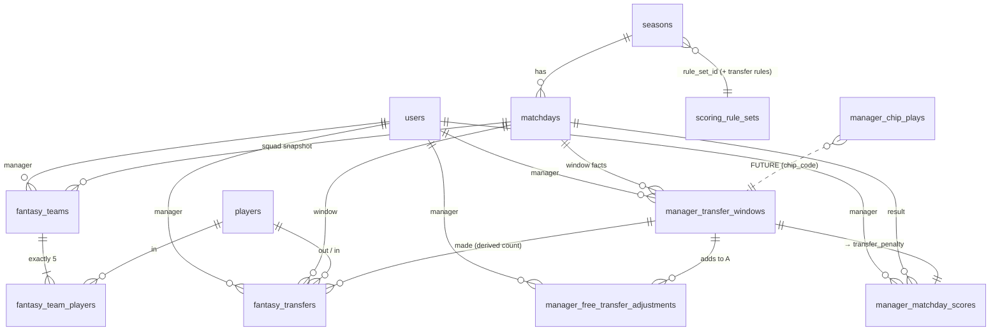

# Fantasy Transfers & Free-Transfer Rollover — Product & Technical Plan

> **Status:** PROPOSAL — awaiting approval. **No application code, migrations, UI or config has been changed.**
> **Date:** 2026-11-06
> **Scope:** Amends the product/technical plan for the Mkate Champions League (Sunday 5-a-side fantasy league, ~12 matchdays per ~3-month season, ~12 managers).

> **Note on "the existing approved plan":** the repository contains no standalone plan document — only `README.md` ("managers pick five real players plus captain and vice; admin publishes match results and gameweek scores") and `docs/LAUNCH.md`. This document therefore amends the plan **as built**, which I derived by reading the code (`src/server/**`, `src/components/pick/**`, schema, tests). If the approved plan lives somewhere else (Notion, a Claude plan file, an issue), tell me and I will merge this into it instead of leaving it as a standalone amendment.

---

## 0. Summary of proposed changes

1. **Managers keep one evolving five-player squad.** From the first transfer-enabled matchday, a manager can no longer replace the whole team freely. Changing a squad is expressed as **transfers** (one player out, one player in).
2. **Free-transfer economy:** 2 free transfers are granted per matchday, unused ones roll over, the bank is capped at 3, and each transfer beyond the available free ones costs **−4 manager points**.
3. **Captain / vice-captain changes stay free** and are independent of transfers.
4. **The server is the only authority.** Free-transfer availability, transfer counts and penalties are computed server-side from stored facts by a pure function. They are never accepted from the client and never kept in a mutable counter.
5. **Transfers are derived from squads, not accumulated from API calls.** The number of transfers in a window is `|submitted squad − base squad|`. Re-submitting, retrying, or swapping a player out and back in can never inflate the count. This is the key design choice that makes the system tamper-proof and retry-safe (§3.2).
6. **Schema: extend, do not replace.** Keep the existing per-matchday squad snapshots (`fantasy_teams` / `fantasy_team_players`) as the source of truth. Add a small transfer record (`fantasy_transfers`), a per-matchday window record (`manager_transfer_windows`), an append-only admin adjustment ledger (`manager_free_transfer_adjustments`), two additive columns on `manager_matchday_scores`, and four transfer-rule columns on `scoring_rule_sets` (§7).
7. **Penalties live only on the manager's matchday score** (`manager_matchday_scores.transfer_penalty`), never in `point_ledger` or any real player's totals. Recompute reads them from stored facts, so they cannot be lost or duplicated (§4).
8. **Backward compatible and opt-in per season** via `scoring_rule_sets.transfers_start_matchday` (null = today's unrestricted behaviour). The current season can switch on from the next unpublished matchday without touching history (§11).
9. **Chips are not built now**, but the window record, scoring pipeline stages and squad-lineage rules include explicit extension points for Wildcard and Free Hit and do not block the other proposed chips (§5).
10. **A mobile-first "Transfers" screen** replaces the whole-team picker, with a live summary, penalty previews, a confirm step that is deliberately hard to pass by accident, a history tab, and a clear locked state (§8).

---

## 1. Current behaviour (as built) and conflicts with the new rules

### 1.1 What exists today

| Area | As built | Where |
|---|---|---|
| Squad model | One full snapshot per `(manager, matchday)` in `fantasy_teams` + `fantasy_team_players`. Unique `(manager_id, matchday_id)`. `version` column, `source` ∈ `manual / admin / carry_over`. | `schema.ts` |
| Saving | `saveFantasyTeam` **deletes and re-inserts** the whole team on every save. Any 5 active players. No limit on changes. | `domain/save-fantasy-team.ts` |
| Lock | `isLocked`: status `published`/`cancelled`, or `now >= deadlineAt`. Checked against **DB time** inside the transaction, after `SELECT … FOR UPDATE` on the matchday row. | `fantasy/lock.ts` |
| Carry-over | `resolveEffectiveTeam`: team on the matchday if manual/admin, else the latest earlier manual/admin team. `recompute` materialises `carry_over` rows for published matchdays. | `fantasy/effective-team.ts`, `recompute-manager-scores.ts` |
| Scoring | per-player base points (sum of `point_ledger`) × captain multiplier (captain if they attended, else vice) → lines + `manager_matchday_scores.total_points` → `manager_rank_snapshots`. Recompute rebuilds scores **from matchday N forward**. | `scoring/manager-score.ts` |
| Admin override | `overrideFantasyTeamAdminAction` replaces a team with a reason, audited, recomputes if published. | `actions/fantasy-team.ts` |
| Cancel / postpone | Cancel sets `status='cancelled'`, audits, recomputes. Postpone changes `playedOn` + deadline. | `domain/matchdays-admin.ts` |
| Config | `league_settings` (timezone, kickoff, deadline offset) and `scoring_rule_sets` (points + `captain_multiplier`), referenced by `seasons.rule_set_id`. | `schema.ts` |
| Pick UI | `/pick` edits the whole squad; drafts in `localStorage` per matchday. | `components/pick/*` |

### 1.2 Conflicts to resolve

| # | Conflict | Resolution in this plan |
|---|---|---|
| C1 | `saveFantasyTeam` lets a manager replace all five players every matchday. | Managers go through a new `submitTeam` service that enforces transfer rules. Admin override stays but becomes an audited **correction** flow (§9). |
| C2 | `validateFantasyTeam` rejects **inactive** players anywhere in the squad, so a manager could not even change their captain if a squad member was deactivated. | Allow *retaining* an inactive player (they score 0); only forbid transferring one **in**. Needs approval (D5). |
| C3 | `carry_over` materialisation + `rebuildManagerScoresFromMatchday` delete and recreate carry rows/scores. | Transfers/windows are **separate tables that recompute only reads**, so recompute cannot lose or duplicate penalties. Carry-over remains the base-squad lineage. |
| C4 | `cancelMatchdayAdmin` only flips status and recomputes. | Must also void that matchday's window/transfers and rebuild the balance chain (§6.1). |
| C5 | `manager_matchday_scores.total_points` has no notion of penalty; rank snapshots drop managers with `points <= 0` (`filter(row.points > 0)`). | Add `squad_points` + `transfer_penalty`; change the rank filter to "has a scored team" so a penalised manager is never dropped from the table. |
| C6 | Recompute scores every user with role `manager`/`admin` and ignores `users.status`. | Respect `status='disabled'` for transfers and (with approval) for rankings going forward (§6.9). |
| C7 | Pick UI keeps a whole-team draft in `localStorage` that can go stale against server state. | New transfers UI stores only a **delta against a server-provided base**, validated on load (§8.5). |
| C8 | Admin override (`delete + insert`) can silently change what later transfer diffs mean. | Corrections are explicit, audited, previewed, and cascade deterministically (§9.3). |
| C9 | There is no per-manager join date; `users.createdAt` is the invite acceptance time, not a matchday boundary. | "Joined" is derived from the first squad submission — no join date needed (§6.2). |
| C10 | `fantasy_teams` delete+insert on every save churns ids and resets `version`. | Update in place; keep `version` monotonic for optimistic concurrency (§3.4). |

---

## 2. Functional requirements (updated)

### Squad & transfers
- **FR-1** Each manager's team for every matchday has exactly **5 unique** real players. No budget, positions or formations.
- **FR-2** Different managers may select the same real player.
- **FR-3** A manager's squad **persists between matchdays** (it is the base for the next one) unless changed by transfers.
- **FR-4** A **transfer** replaces one existing squad player with one eligible player. A window's transfer count is the number of players in the submitted squad who are not in the base squad.
- **FR-5** A manager's **first-ever squad in a season is an unrestricted initial build** (not transfers, no penalty).
- **FR-6** Captain and vice-captain can change every matchday at no cost, independent of transfers.
- **FR-7** Squad and transfers can only be changed for the **next open matchday**, and only before its deadline. After the deadline everything for that matchday is locked.

### Free transfers & penalties
- **FR-8** Every transfer-eligible matchday grants **2** free transfers. Unused free transfers roll over. The bank at the start of any matchday is capped at **3**.
- **FR-9** Making more transfers than available is allowed; **each extra transfer costs −4** on that manager's matchday score. Penalties accumulate.
- **FR-10** Penalties are applied to the **manager's matchday score only**. They never alter real players' points, standings or awards.
- **FR-11** Penalties are shown in the score breakdown.

### Integrity
- **FR-12** The server computes availability, usage and penalties. The client's numbers are display-only.
- **FR-13** Submissions are atomic, idempotent under retries, and safe under concurrent requests.
- **FR-14** Historical matchdays (locked/cancelled/published) are immutable to managers. Only an audited admin correction can change them.

### Admin
- **FR-15** Admin can view transfer activity across managers, per-manager history, balances, and who incurred penalties.
- **FR-16** Admin can make corrections and grant extra free transfers **only** through audited, append-only mechanisms; nothing is edited silently.
- **FR-17** Transfer rules are configurable **per season** (via its rule set), not globally mutable mid-season.

---

## 3. Business rules

### 3.1 Terminology

| Term | Meaning |
|---|---|
| **Squad** | A manager's 5 players for a matchday (`fantasy_team_players`). |
| **Base squad** | The squad the manager had **going into** matchday *m*: the final permanent squad of the latest earlier **non-cancelled** matchday (this is exactly what `resolveEffectiveTeam` already computes). |
| **Window** | The period in which a manager may change their squad for matchday *m* (from when the previous matchday locks until *m*'s deadline). One window per manager per matchday. |
| **Transfer-eligible matchday** | A non-cancelled matchday at or after the manager's chain start (§3.3). |
| **Free available (A)** | Free transfers the manager may use in this window. |
| **Made (n)** | `|submitted squad \ base squad|`. |
| **Extra (x)** | `max(0, n − A)`. |
| **Penalty (P)** | `−x × extra_transfer_penalty` (default −4). |

### 3.2 The transfer-count rule (the core design decision)

> **The number of transfers in a window is a pure function of two sets: the base squad and the submitted squad. It is never incremented by API calls.**

Consequences:
- Submitting the same squad twice (retry, double-tap, two tabs) → same result. **No double counting.**
- Swapping A→B and then B→A before the deadline → squad equals base → **0 transfers, 0 cost**.
- A manager cannot "farm" or "burn" free transfers by calling the API repeatedly.
- The only way to change the count is to change the actual squad.

Pairing of "out" and "in" players for display is presentational (the UI records which slot was replaced); it has no effect on counts or scoring.

### 3.3 Free transfer balance

Evaluate for each transfer-eligible matchday *m* in order, per manager:

```
base_m      = min(cap, carry_{m-1} + grant)        # grant = 2, cap = 3, carry_0 = 0
A_m         = base_m + adjustments_m               # admin grants, default 0
n_m         = transfers made in the window         # 0 if no submission
extra_m     = max(0, n_m − A_m)                    # transfers beyond the free allowance
penalty_m   = extra_m × 4                          # applied as −penalty on the manager's score
carry_m     = max(0, A_m − n_m)                    # normal matchday
carry_m     = base_m                               # chip matchday (Wildcard / Free Hit): allowance preserved
```

Cancelled matchdays are **skipped** (no grant, no use, no change to the carry) — see §6.1. Unused free transfers above the cap are discarded by the `min(cap, …)`.

**Verification against the examples in the brief** (grant 2, cap 3):

| Matchday | Available | Used | Carried forward | Check |
|---|---:|---:|---:|---|
| 1 | `min(3, 0+2)=2` | 0 | 2 | ✓ |
| 2 | `min(3, 2+2)=3` | 1 | 2 | ✓ |
| 3 | `min(3, 2+2)=3` | 2 | 1 | ✓ |
| 4 | `min(3, 1+2)=3` | 3 | 0 | ✓ |
| 5 | `min(3, 0+2)=2` | 1 | 1 | ✓ |

| Scenario | A | n | Extra | Penalty |
|---|---:|---:|---:|---:|
| Uses both | 2 | 2 | 0 | 0 |
| Uses one | 2 | 1 | 0 | 0 |
| Saves both | 2 | 0 | 0 | 0 |
| 3 banked, uses 1 | 3 | 1 | 0 | 0 |
| 3 banked, uses 4 | 3 | 4 | 1 | −4 |
| 2 available, makes 4 | 2 | 4 | 2 | −8 |

These tables become **unit-test fixtures** (§12).

**Chain start & initial build.** The chain starts at the manager's first *transfer-eligible* matchday = the matchday **after** their initial build (FR-5), or the season's `transfers_start_matchday` for managers who already have a squad when the feature is switched on. The first window of the chain has `carry_0 = 0`, so `A = 2` (matches the "Matchday 1" row above — in the brief's tables, "Matchday 1" is the manager's first transfer-eligible matchday).

### 3.4 Validation rules (server-side, in one transaction)

A submission `{ matchdayId, playerIds[5], captainPlayerId, viceCaptainPlayerId, expectedVersion, acknowledgedPenalty }` is accepted only if **all** hold:

1. Caller is an authenticated, **active** manager; target is *their own* team.
2. `matchdayId` is the **next open matchday** (not cancelled, not published, `now < deadline_at` by **DB time**). Manager endpoints never accept an arbitrary historical matchday.
3. Squad has exactly 5 unique players; captain ≠ vice; both are in the squad (existing `validateFantasyTeam` rules).
4. Every **incoming** player exists and is `active` (eligibility, see D5/§6.3). Every **outgoing** player was actually in the base squad (implicit in the diff; a client cannot "transfer out" someone they don't own).
5. No incoming player is already in the base squad (they'd simply not be a transfer — a no-op, not an error).
6. `expectedVersion` matches the stored team version, **or** the stored squad already equals the request (idempotent replay → return success).
7. If `extra > 0`, then `acknowledgedPenalty ≥ penalty` as computed **by the server**; otherwise reject with `PENALTY_NOT_CONFIRMED` carrying the server's numbers. This prevents surprise penalties and stale confirmations.

On any failure the transaction rolls back: **no partial updates** to squad, transfers or window.

### 3.5 Concurrency, idempotency, atomicity

Single `db.transaction`:

1. `SELECT … FOR UPDATE` the matchday row (existing pattern) — also serialises with the admin cancel/postpone/publish paths.
2. `pg_advisory_xact_lock(hash(manager_id, season_id))` — serialises a manager's own parallel requests (two tabs, double-tap, retries) without serialising other managers.
3. Read **DB `now()`** and re-check the lock.
4. Resolve the base squad and the balance chain (pure functions over rows read in this transaction).
5. Update squad rows **in place**, replace the open window's `fantasy_transfers` rows (they are a derived materialisation of the diff while the window is open), upsert the window row, bump `version`.
6. Commit. Retrying any step after a network failure either returns the replayed success (rule 6) or a clean `CONFLICT` for a genuinely stale request.

Hardening (recommended): a **deferred constraint trigger** asserting each `fantasy_teams` row has exactly 5 `fantasy_team_players` at commit, so no concurrency bug can ever leave a 4- or 6-player team.

### 3.6 Immutability

- A window is mutable **only** while its matchday is open. After the deadline the service rejects everything for that matchday.
- `fantasy_transfers` rows for a locked window are never updated or deleted by application code. Admin changes are **new** rows plus `voided_at` markers and an `audit_log` entry (§9).

---

## 4. Scoring: order of calculation

Manager matchday score is computed in a fixed, documented order. Each stage has a single responsibility so future chips can hook in without rewriting the rest.

| Stage | What happens | Today | Future chip hook |
|---|---|---|---|
| **1. Player base points** | Sum of `point_ledger` for each squad player (real-player points; unchanged). | ✓ | Goal Rush / Underdog Boost / Team Spirit may **add bonus** per-player amounts here. |
| **2. Availability** | Players who did not attend score 0 and are flagged `attended=false`. | ✓ | — |
| **3. Captain / vice multiplier** | Multiplier applied to the captain's base points, or the vice's if the captain did not attend (`captainMultiplier`, default 2). | ✓ | **Triple Captain** = multiplier 3 (parameter, not new logic). |
| **4. Squad subtotal** | `squad_points = Σ player line points`. | ✓ (as `total_points`) | **Safety Net** floor/bonus applied to the subtotal here. |
| **5. Transfer penalty** | `transfer_penalty = −extra × penalty_per_extra`. Wildcard/Free Hit windows have `extra = 0`. | NEW | — |
| **6. Matchday total** | `total_points = squad_points + transfer_penalty`. Negative totals allowed (no floor — D4). | NEW | — |

Rules:
- The penalty is **never** a `point_ledger` row and never touches a real player's totals, rankings, awards (Golden Boot etc.) or form.
- It is shown as its own line in the breakdown ("Transfers: 3 made, 2 free → 1 extra = −4").
- **Recompute safety:** `rebuildManagerScoresFromMatchday` deletes and re-inserts `manager_score_lines`/`manager_matchday_scores` from matchday *N* forward. It will **read** the window + transfer rows to derive `transfer_penalty`; it never writes them (except the admin-correction path, §9.3). Because penalties are a pure function of stored facts, running recompute any number of times yields the same numbers — nothing is lost, nothing is applied twice.
- **Reproducibility:** each window stores the facts needed to reproduce history even if rules change later: `free_available`, `unlimited`, `penalty_per_extra`, `chip_code`.

---

## 5. Chips: design constraints (not implemented now)

Chips will be a thin layer over the same two primitives (window + squad lineage), so no later rewrite of transfers is needed.

### 5.1 Extension points reserved now

- `manager_transfer_windows.chip_code` (nullable text) and `unlimited` (bool) — **present from day one**.
- Squad lineage (`resolveEffectiveTeam` equivalent) takes an `is_temporary` predicate; **`fantasy_teams.is_temporary boolean default false` is added when chips ship** (additive, cheap). Until then no temporary squads exist.
- Scoring stages 1, 3, 4 are the documented hook points (§4).
- Future table (not created now): `manager_chip_plays(manager_id, season_id, matchday_id, chip_code, params jsonb)` with unique `(manager_id, matchday_id)` and per-season uniqueness rules per chip. The window row references the chip by `chip_code`, so there is a single source of truth.

### 5.2 Wildcard

- Marks the window `unlimited = true`: any number of transfers, `extra = 0`, no penalty.
- The squad change is **permanent** (it is a normal squad update).
- Normal rollover continues: `carry_m = base_m` — the manager's allowance for that matchday is **preserved** (not consumed, not lost). *(D10 — recommended default; matches FPL intuition.)*

### 5.3 Free Hit

- Manager picks a **temporary** 5-player squad for that matchday only (`fantasy_teams.is_temporary = true`).
- The temporary squad is **excluded from squad lineage**: the next matchday's base squad is the permanent squad from before the Free Hit — restoration is automatic, with no restore job.
- During a Free Hit window: no transfer rows, no penalty, no consumption of free transfers; the matchday's grant still happens and `carry_m = base_m` (as if the manager skipped the window). Captain/vice are still chosen for the temporary squad.

### 5.4 Other proposed chips

| Chip | Interaction with transfers | Blocked by this design? |
|---|---|---|
| Triple Captain | Multiplier parameter at stage 3. No transfer interaction. | No |
| Underdog Boost | Per-player bonus at stage 1 based on standings; independent of transfers. | No |
| Safety Net | Floor/bonus on `squad_points` at stage 4; penalties (stage 5) still apply after it unless a rule says otherwise. | No |
| Goal Rush | Adjusts goal points at stage 1. | No |
| Team Spirit | Bonus based on squad composition (e.g. same-side players) at stage 1/4; uses the final squad, so it is unaffected by how it was built. | No |

Chip rules for later: chips are declared before the deadline in the same transaction as the squad; at most one chip per matchday; chip legality (uses per season) validated server-side.

---

## 6. Exceptional scenarios

| Scenario | Rule | Notes |
|---|---|---|
| **6.1 Matchday cancelled** | Cancelled matchdays are **void windows**: transfers made for that matchday are marked `void`, its squad submission is discarded from lineage, **no free transfers are granted and none consumed**, no penalty is possible. The manager's pre-existing squad stays their current squad. Managers see "GW cancelled — your pending changes were cleared; your free transfers are unchanged." | Done in the same transaction as `cancelMatchdayAdmin`. If the matchday was already published, the balance chain is **rebuilt forward** and the admin sees a preview of any later windows affected (D3). |
| **Postponed** | Status stays `scheduled`; only `playedOn` and `deadline_at` change (existing). Windows are keyed by matchday id so balance and pending drafts are untouched. The new deadline applies to the same window. | Postponing never grants or removes transfers. |
| **6.2 Manager joins mid-season** | First-ever squad is a **free initial build** (FR-5) for whichever open matchday they first submit in. Their chain starts at the **next** matchday with `A = 2`. No back-pay of missed grants. | "Joined" is derived from the first squad row — no join-date column. |
| **6.3 Real player unavailable after deadline** | Nothing changes: the player scores 0 (`attended=false`); the existing rule promotes the vice-captain if the captain did not play. **No automatic free transfers** are granted. | If the league wants compensation, the admin uses an explicit **adjustment** (+N free transfers, reason, audited) — a manual, visible action (§9). |
| **Player deactivated before the deadline** | Retaining them is allowed (they just score 0); they cannot be transferred **in**. Replacing them is a normal transfer (not free unless admin adds an adjustment). | Changes C2 (D5). |
| **6.4 No transfers** | `n = 0`, window `carry = min(cap, …)`; the squad carries over untouched. Captain-only changes cost nothing. | |
| **6.5 Uses all free transfers** | `extra = 0`, `carry = 0`; next matchday starts at `min(3, 0+2) = 2`. | |
| **6.6 Exceeds free allowance** | Allowed. Penalty `−4` per extra, confirmed explicitly in the UI and acknowledged in the request (§3.4 rule 7). | |
| **6.7 Submits after deadline** | Rejected with `LOCKED`. DB time, not client time. | Same transaction check as today. |
| **6.8 Admin corrects a matchday (match events)** | Real-player points are recomputed as today. Transfer facts are unaffected, so penalties are unchanged and **cannot be lost or duplicated**; the manager total is re-derived (`squad_points` changes, `transfer_penalty` is re-read). | §4. |
| **6.9 Manager leaves / is removed** | Use `users.status='disabled'` (preferred) — never hard-delete. Disabled managers cannot submit; their history is preserved; they stop accruing grants (freeze). Rankings exclude them going forward (D6/C6). Hard delete cascades to their squads/transfers by FK and is discouraged. | Reactivation resumes the chain from the frozen carry. |
| **6.10 Season rollover** | A new season = new chain: initial build is free and unrestricted, `carry` resets to 0, the transfer rules come from the new season's rule set. Nothing carries across seasons (squad prefill from last season is an optional UX convenience that still counts as the free initial build). | `closeSeasonAdmin` needs no transfer logic beyond "windows are season-scoped". |
| **Two matchdays between deadlines / only next matchday editable** | Managers can transfer only for the **next open** matchday. | Keeps the model simple. |

---

## 7. Database design

### 7.1 Decision: extend the current model (do **not** replace it)

A pure event-sourced transfer ledger would force rewriting `resolveEffectiveTeam`, `carry_over` materialisation, `recompute`, every `fantasy-team-view` query and the public profile UI. For a casual league (12 managers × 12 matchdays) that is unjustified risk.

**Recommended model:**
- **Squad snapshots stay the source of truth** for "which five players a manager selected".
- **`fantasy_transfers`** records the diff (who went out / came in) for history, UI and audit.
- **`manager_transfer_windows`** records the per-matchday allowance facts (`free_available`, `chip`, `penalty_per_extra`).
- **Balance is never a stored, mutable counter.** It is computed by a pure function over window rows (§3.3), so there is no second, conflicting representation of the same balance.
- **Penalty and totals are *results*** stored once, in `manager_matchday_scores`, like `total_points` already is.

### 7.2 New and changed tables

**`scoring_rule_sets`** (changed — additive columns, season-versioned config)
| Column | Type | Default | Meaning |
|---|---|---|---|
| `free_transfers_per_matchday` | smallint not null | 2 | grant |
| `max_banked_free_transfers` | smallint not null | 3 | cap |
| `extra_transfer_penalty` | smallint not null | 4 | points per extra |
| `transfers_start_matchday` | integer null | null | `null` = transfers off (today's behaviour); otherwise rules apply from this matchday number |

Rule sets are treated as immutable once their season has a locked matchday (admin creates a new rule set for the next season) — this is the "configure for future seasons" requirement.

**`fantasy_transfers`** (new)
| Column | Type | Notes |
|---|---|---|
| `id` | uuid pk | |
| `season_id`, `manager_id`, `matchday_id` | uuid fk | `manager_id` cascade like `fantasy_teams` |
| `seq` | smallint | 1..n within the window (order of pairing for display) |
| `player_out_id`, `player_in_id` | uuid fk → players | `CHECK (player_out_id <> player_in_id)` |
| `status` | enum `active \| void` | `void` for cancelled matchdays / admin corrections |
| `source` | enum `manager \| admin_correction` | |
| `created_at`, `voided_at`, `void_reason`, `voided_by` | | audit trail |

Indexes/constraints: partial unique `(manager_id, matchday_id, player_out_id) WHERE status='active'`, same for `player_in_id`, and `UNIQUE (manager_id, matchday_id, seq) WHERE status='active'`. "Penalised" is **derived** (`seq > free_available`), not stored.

**`manager_transfer_windows`** (new) — one row per `(manager, matchday)`
| Column | Type | Notes |
|---|---|---|
| `manager_id`, `matchday_id` | uuid | **PK** together |
| `season_id` | uuid | |
| `free_available` | smallint | snapshot of `A_m` (includes adjustments) |
| `unlimited` | boolean default false | Wildcard (and future chips) |
| `chip_code` | text null | reserved for chips |
| `penalty_per_extra` | smallint | snapshot of the rule at the time |
| `voided_at` | timestamptz null | cancelled matchday |
| `created_at`, `updated_at` | | |

Window rows are written by **exactly two code paths**: the submit service and the recompute/admin-correction cascade. Everything else reads. `transfers_made`, `extra` and `penalty` are **derived** (count of active transfer rows, `max(0, made − free_available)`, `× penalty_per_extra`) — only the final `transfer_penalty` result is stored on the score row.

**`manager_free_transfer_adjustments`** (new, append-only ledger)
`id`, `manager_id`, `matchday_id`, `delta smallint CHECK (delta <> 0)`, `reason text not null`, `created_by`, `created_at`. Used for explicit admin compensation (e.g. a player became unavailable). Included in `A_m`. Never updated or deleted.

**`manager_matchday_scores`** (changed — additive)
`squad_points integer not null default 0`, `transfer_penalty integer not null default 0` (≤ 0), with `CHECK (total_points = squad_points + transfer_penalty)`. Backfill: `squad_points = total_points`, `transfer_penalty = 0`.

**`fantasy_teams`** (no change now) — update in place instead of delete+insert. `is_temporary boolean default false` is added when chips ship.

**`audit_log`** (existing) — reused for all admin corrections and adjustments (`before`/`after` JSON).

### 7.3 ERD



### 7.4 Historical reconstruction (all supported without ambiguity)

| Question | Source |
|---|---|
| Which five players? | `fantasy_teams` + `fantasy_team_players` for that matchday |
| Who was transferred in/out? | `fantasy_transfers` (`status='active'`) |
| Free transfers available? | `manager_transfer_windows.free_available` (and recomputable via the §3.3 walker) |
| Transfers used? | `count(fantasy_transfers where status='active')` |
| Which incurred penalties? | transfers with `seq > free_available` |
| Final matchday score? | `manager_matchday_scores` (`squad_points`, `transfer_penalty`, `total_points`) |
| Who changed what, when? | `audit_log` + `voided_*` columns |

### 7.5 Integrity safeguards

- Exactly 5 players per team via a deferred constraint trigger (recommended hardening).
- `CHECK (captain <> vice)` already exists.
- Partial unique indexes above prevent duplicate transfer rows.
- Window PK prevents two windows for one `(manager, matchday)`.
- A test asserts `transfers_made` derived from rows equals the diff of consecutive squads for every window (consistency guard).

---

## 8. UI / UX (mobile-first)

Replaces the whole-team picker at `/pick` with a **Transfers** experience (route can stay `/pick`; "Pick Team" label can become "Transfers" once enabled).

### 8.1 Screen structure

1. **Header band (sticky):** matchday label, **deadline countdown** (existing `DeadlineCountdown`, server-skew corrected), and a **free-transfer pill** ("2 free").
2. **Transfer summary strip** — always visible, updates live:
   ```
   Free available  2   ·   Made  3   ·   Extra  1   ·   Penalty  −4
   ```
   Penalty cell turns amber/red only when > 0.
3. **Pitch** (reuse `FantasyPitch` visual language) with the 5 current players. Each card has a "Transfer" affordance.
4. **Player tap sheet** (reuse `SlotActionSheet`): *Transfer out*, *Make captain*, *Make vice-captain* — captain actions are free and clearly labelled "Free".
5. **Replacement picker** (reuse `PlayerPickerSheet`): search + sort; each row shows form/expected points; **if the next transfer would be extra, a banner at the top of the sheet says "This transfer costs −4"** *before* the user selects anyone.
6. **Pending state on the pitch:** players going out show greyed with an "OUT" badge and an **Undo**; incoming players show "IN". Re-selecting the original player automatically cancels the transfer (diff model, §3.2).
7. **Confirm sheet:** list of out→in pairs with shirts, the summary block, and:
   - 0 extra: primary button "Confirm transfers".
   - extra > 0: red callout "−4 points", and the button is **disabled until the user ticks "I understand this costs 4 points"**; the label changes to "Confirm (−4 pts)". The checkbox state is sent as `acknowledgedPenalty` (the server still validates).
8. **History tab:** per matchday — shirts in/out, badges `Free` / `−4`, free-transfers used/available. Visible to others only after the deadline (same visibility rule as teams).
9. **Locked state:** after the deadline the screen becomes read-only with a clear banner ("Locked — GW3 kicked off"), the final squad, and what was confirmed.

### 8.2 Making an accidental penalty hard

- The summary strip, the picker banner and the confirm sheet all show the cost **before** it is committed.
- An extra transfer cannot be submitted without the explicit acknowledgement checkbox.
- The "Reset to current squad" button restores the base squad in one tap.
- Penalty colour (amber → red) is used **only** for penalties, never for neutral states.

### 8.3 Feedback

- Success toast: "Team confirmed — 2 transfers (free)". Failure toasts map server codes (`LOCKED`, `CONFLICT`, `PENALTY_NOT_CONFIRMED`, `INELIGIBLE_PLAYER`) to plain language; a `CONFLICT` offers "Reload latest".
- Optimistic UI is limited to the local draft; the saved state always comes from the server response.

### 8.4 Accessibility

Live region on the summary strip, focus management when sheets open/close (already handled by the dialog-based `BottomSheet`), tap targets ≥ 44px, reduced-motion respected, the penalty communicated with text, not colour alone.

### 8.5 Draft handling

The client stores only `{ matchdayId, baseVersion, plannedPlayerIds, captain, vice }`. On load, if `baseVersion` differs from the server's (e.g. admin correction, cancelled matchday) the draft is discarded with a short explanation. The server's numbers always win.

### 8.6 Other screens that change

- **Manager gameweek card / breakdown modal:** add a "Transfers" row — "3 made · 2 free · −4" — and show the penalty in the points total.
- **Gameweek card header** shows `Points` = `total_points` with `squad + transfer_penalty` visible on tap.
- **My Team page:** shows "Free transfers: 2" and the next deadline.

---

## 9. Admin requirements

### 9.1 Screens

- **`/admin/transfers`** — table: manager × matchday with `free_available`, `made`, `extra`, `penalty`, filters (matchday, "penalised only"), and sort by penalty.
- **Manager transfer history** — timeline of windows, transfers (with void markers), adjustments, and relevant audit entries.
- **Balances** — current `A` and projected carry per manager.
- **Penalty report** — managers with penalties this season + total points lost.
- **Rules** — transfer rule fields on the season/rule-set form, editable only before the season has a locked matchday.

### 9.2 Actions (all audited, none silent)

| Action | Mechanism |
|---|---|
| Grant extra free transfers | New row in `manager_free_transfer_adjustments` (reason required) + `audit_log`. |
| Correct a manager's transfers after the deadline | `adminCorrectTransfers`: voids affected `fantasy_transfers` rows (`void_reason`), inserts replacement rows with `source='admin_correction'`, writes `before/after` to `audit_log`. |
| Correct a past squad | Existing override becomes a correction with required reason and impact preview (below). |

### 9.3 Impact preview and cascade

Because balance is a pure chain, correcting matchday *m* can change later windows (carry changes) and therefore later penalties. The admin tool **previews** "this changes GW *k*: Manager X penalty −4 → 0" and requires explicit confirmation. On confirm, a single transaction rewrites the affected windows forward and then runs the existing `rebuildManagerScoresFromMatchday`, with one audit entry per changed window. Nothing in history changes without such an entry.

### 9.4 What admin cannot do

Edit a locked window directly in SQL-like fashion through the UI, or change a rule set that already has locked matchdays.

---

## 10. Backend services and endpoints

The app uses **Next.js server actions + domain services** (not REST). "Endpoints" below are server actions.

### 10.1 Pure domain modules (unit-tested, no DB)

| Module | Responsibility |
|---|---|
| `fantasy/transfer-diff.ts` | `diffSquads(base, next)` → `{ in[], out[] }` |
| `fantasy/free-transfers.ts` | `computeBalanceChain(windows[], adjustments[], rules, eligibleMatchdays[])` → per-matchday `{ available, made, extra, carry }` |
| `fantasy/transfer-summary.ts` | `summarise(base, next, available, rules)` → the numbers shown in the UI **and** used by the server |
| `fantasy/validate-transfers.ts` | eligibility + invariants (extends `validate-team.ts`) |
| `scoring/manager-score.ts` (extended) | adds stage 5/6 (penalty) after the existing multiplier logic |

The same `summarise` function is shared by client (instant UI) and server (authoritative) — the server never trusts the client's result.

### 10.2 Services

| Service | Notes |
|---|---|
| `domain/submit-team.ts` | The only path managers use to change a squad. Implements §3.4/§3.5. Replaces manager use of `saveFantasyTeam`. |
| `domain/transfer-windows.ts` | Read/write window rows; `ensureWindowsThrough` used by recompute. |
| `domain/transfer-history.ts` | Query helpers for UI/admin. |
| `domain/admin-transfers.ts` | adjustments, corrections, impact preview, cascade. |
| `domain/recompute-manager-scores.ts` (extended) | reads windows/transfers to derive `transfer_penalty`; never writes transfer facts. |
| `domain/matchdays-admin.ts` (extended) | `cancelMatchdayAdmin` voids the window + transfers and rebuilds the chain. |
| `domain/close-season.ts` | no change beyond season-scoped queries. |

### 10.3 Server actions

**Manager**
- `getTransferPageData(matchdayId?)` → `{ matchday, deadline, serverNow, locked, baseSquad, currentSquad, version, window: { freeAvailable, made, extra, penalty }, players, history }`
- `submitTeamAction(matchdayId, { playerIds, captain, vice, expectedVersion, acknowledgedPenalty })` → `{ teamId, version, summary }` or a typed failure.
- `previewTransferSummaryAction(matchdayId, playerIds)` → authoritative summary without writing (optional; the client can use the shared pure function).
- `listMyTransferHistoryAction()`

**Admin**
- `listTransferActivityAction(filters)`, `getManagerTransferHistoryAction(managerId)`
- `previewTransferCorrectionAction(...)`, `applyTransferCorrectionAction(...)`
- `grantFreeTransfersAction(managerId, matchdayId, delta, reason)`
- `updateTransferRulesAction(ruleSetId, ...)` (blocked once the season has a locked matchday)

**Error codes:** `LOCKED`, `CANCELLED`, `NOT_NEXT_MATCHDAY`, `SQUAD_SIZE`, `DUPLICATE_PLAYER`, `INELIGIBLE_PLAYER`, `CAPTAIN_*`, `CONFLICT`, `PENALTY_NOT_CONFIRMED`, `MANAGER_DISABLED`, `VALIDATION`.

---

## 11. Migration and backward compatibility

- **One additive migration** (`0008_transfers.sql`): new tables, new columns with defaults, backfill `squad_points = total_points`. No drops, no renames.
- **Feature switch:** `scoring_rule_sets.transfers_start_matchday` (null = off). While null, `saveFantasyTeam` keeps working exactly as today — the old picker and every current test keep passing.
- **Enabling on the live season:** set `transfers_start_matchday` to the next **unpublished** matchday (e.g. GW3). Matchdays before it stay unrestricted with `transfer_penalty = 0`. Existing managers' squads become the base squads; the first window of the chain grants `A = 2`. **No retroactive penalties.**
- **Existing data:** `manager_matchday_scores` rows get `squad_points = total_points`, `transfer_penalty = 0`. No synthetic transfer rows are created for history.
- **Rank snapshots:** change the `points > 0` filter to "has a scored team" in the same release as penalties (C5).
- **Rollback:** disable by setting `transfers_start_matchday` back to null for matchdays not yet locked; existing transfer rows remain as inert history.
- **Tests:** existing integration tests (`fantasy-team-save`, `recompute`, `manager-scoring`, `matchdays-admin`) must stay green with the flag off.

---

## 12. Test plan

### 12.1 Unit (no DB)
- `diffSquads`: no change, 1/2/5 changes, swap-back = 0.
- `computeBalanceChain`: **every example table in §3.3 as fixtures**; cap discard; chain start; cancelled matchdays skipped; adjustments; wildcard/free-hit preserve carry.
- `summarise`: extra/penalty arithmetic (−4, −8), unlimited windows.
- `validate-transfers`: ownership, duplicates, inactive incoming, retained-inactive allowed, captain/vice rules.
- Scoring order: base → multiplier → subtotal → penalty → total, with captain-DNP→vice fallback and negative totals.

### 12.2 Integration (real DB, isolated `fantasy_test`)
- Submit happy path; atomic rollback on failure (nothing partially written).
- **Concurrency:** parallel `Promise.all` submits for one manager (same and different payloads) → one consistent result; transfer counts correct; no duplicate team members.
- **Idempotent replay:** same request twice and a stale `expectedVersion` with an equal squad → success without double counting.
- Deadline boundary using DB time (just before/after); cancelled/published locked.
- Penalty confirmation: `PENALTY_NOT_CONFIRMED` carries server numbers; stale acknowledgement rejected.
- Cancel matchday: window/transfers voided, balance unchanged, no penalty, chain rebuilt when already published.
- Postpone: balance and pending state untouched, new deadline honoured.
- Mid-season join: free initial build, chain starts next matchday with 2.
- Recompute idempotence: run 10× → identical `transfer_penalty`; match-event correction does not change penalties.
- Admin correction: audit entry per changed window, cascade correct, impact preview matches result.
- Disabled manager cannot submit; reactivation resumes frozen carry.
- Season rollover: new chain, carry 0.
- Migration with flag off: existing behaviour unchanged.
- Consistency guard: derived `transfers_made` equals the diff of consecutive squads for all windows.

### 12.3 End-to-end (Playwright, mobile viewport)
- Make 1 free transfer → confirm → history shows it.
- Make an extra transfer → summary shows −4 → confirm is blocked until acknowledged.
- Swap a player out and back → summary returns to 0.
- Locked state after the deadline (read-only).
- Penalty visible in the matchday breakdown.
- A11y (axe) on the transfers and confirm screens.

---

## 13. Acceptance criteria

- A manager's team always has exactly 5 unique players for every matchday; this is enforced in the database as well as the app.
- With the rules on, a manager cannot change more than their allowance without an explicit −4 per extra transfer being acknowledged and applied.
- Free-transfer balances match every example in §3.3 for the specified inputs.
- Submitting, retrying, double-tapping or parallel-requesting the same squad never changes the transfer count or the balance.
- All numbers displayed in the UI equal the server's; tampering with the request cannot reduce a penalty.
- Real players' points, standings and awards are identical with and without transfers.
- Re-running recompute any number of times, or correcting match events, never loses or duplicates a penalty.
- Cancelled matchdays never cost a manager transfers or points.
- Locked windows cannot be modified by managers; every admin change appears in the audit log with before/after.
- The score breakdown shows squad points, the transfer line and the total.
- Existing tests pass with the feature off; the feature can be switched on from a chosen unpublished matchday without altering history.

---

## 14. Implementation sequence

| Phase | Work | Depends on |
|---|---|---|
| **0** | Approve the decisions in §15. | — |
| **1** | Pure domain: `transfer-diff`, `free-transfers` (with all §3.3 fixtures), `transfer-summary`, `validate-transfers`, scoring stage 5/6. Heavy unit tests. No DB. | 0 |
| **2** | Migration + Drizzle schema (additive), rule-set columns, backfill, feature flag. | 1 |
| **3** | `submit-team` service with locking, version check, idempotent replay, penalty acknowledgement; integration + concurrency tests. | 2 |
| **4** | Scoring/recompute integration: read windows, write `squad_points`/`transfer_penalty`; rank filter fix. | 3 |
| **5** | Lifecycle hooks: cancel/postpone, disabled managers, season scoping, mid-season join. | 3–4 |
| **6** | Manager UI: transfers screen, summary strip, confirm sheet, history tab, locked state; update breakdown modal/gameweek card. | 3–4 |
| **7** | Admin: activity table, manager history, adjustments, correction + impact preview + cascade, rules form. | 3–5 |
| **8** | E2E + a11y, docs, enable on the live season from the chosen matchday, monitor. | all |

Chips (separate future project) plug into the documented hook points in §5.

### To-do list

- [ ] Approve decisions D1–D10
- [x] Phase 1: pure domain modules + unit tests (all §3.3 fixtures)
- [x] Phase 2: migration `0008_transfers.sql`, schema, rule-set columns, backfill
- [x] Phase 2: deferred "exactly 5 players" constraint trigger
- [x] Phase 3: `submit-team` service (lock order, advisory lock, DB time, version, replay)
- [x] Phase 3: server actions + error codes
- [x] Phase 3: concurrency and atomicity integration tests
- [ ] Phase 4: recompute reads windows; `squad_points` / `transfer_penalty`; fix rank filter
- [ ] Phase 5: cancel/postpone hooks; disabled-manager handling; mid-season join
- [ ] Phase 6: transfers UI (pitch, picker banner, summary, confirm, history, locked)
- [ ] Phase 6: breakdown modal + gameweek card show transfers/penalty
- [ ] Phase 7: admin activity, manager history, adjustments, corrections + preview + cascade
- [ ] Phase 7: transfer rules in the season/rule-set form
- [ ] Phase 8: Playwright + a11y; docs; enable from chosen matchday

---

## 15. Decisions requiring your approval

Each has a recommended default; nothing is built until you confirm.

| # | Question | Recommended default |
|---|---|---|
| **D1** | Is a manager's **first-ever squad** a free unrestricted build, with the 2-free-transfer chain starting at the next matchday? (Alternative: the first matchday already counts, with a pre-existing squad required.) | **Yes** — free initial build; chain starts next matchday with `A = 2`. |
| **D2** | Free transfers are **granted per non-cancelled matchday** as `min(3, carry + 2)` (matches your rollover table). | **Yes.** |
| **D3** | **Cancelled matchday:** void its window and pending changes, grant nothing, consume nothing (balance frozen), discard the submission. (Alternative: keep the submitted squad and carry it forward; or grant the 2 free transfers anyway.) | **Void & freeze**, with a forward-rebuild + admin preview if already published. |
| **D4** | Allow **negative** matchday totals (no floor)? | **Yes**, no floor; fix the rank filter that currently drops managers with ≤ 0 points. |
| **D5** | Allow **retaining** an inactive player in the squad (scores 0), but not transferring one in? | **Yes.** No automatic free transfer when a player is deactivated. |
| **D6** | **Removed/disabled managers:** keep all history, freeze their chain, and exclude them from rankings going forward? | **Yes** (disable, never hard-delete). |
| **D7** | Admin free-transfer **adjustments** may exceed the 3-bank for that single matchday only (the bank cap applies again when carrying forward)? | **Yes.** |
| **D8** | Which transfers are labelled "penalised" when a window exceeds its allowance? | The **last** `extra` transfers by `seq` (display only; the total penalty is identical either way). |
| **D9** | Can managers make **captain/vice-only** changes after using up transfers, at no cost, until the deadline? | **Yes** (FR-6). |
| **D10** | **Chip matchdays (future):** a Wildcard/Free Hit matchday **preserves** the matchday's allowance (`carry = base`) rather than treating it as used. | **Preserve.** |
| **D11** | **Retroactive admin corrections** cascade forward through later balances automatically, with an impact preview and per-window audit entries? | **Yes.** |
| **D12** | Transfers are only possible for the **next open matchday** (not several ahead)? | **Yes.** |
| **D13** | Enable on the live season from the next unpublished matchday (currently **GW3**), with no retroactive penalties? | **Yes.** |

---

## 16. Out of scope (explicitly)

Chips themselves, budgets/pricing, positions/formations, auto-substitutions, price changes, leagues-within-league, push notifications for deadlines, and any microservice or new infrastructure dependency. The plan adds **no dependencies** and no background jobs — everything is deterministic and computed from stored facts inside existing transactions.
